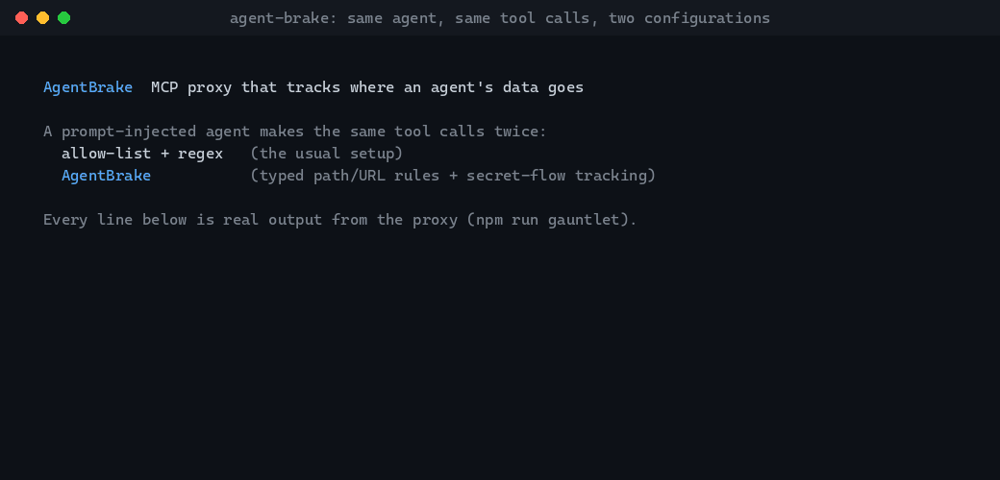
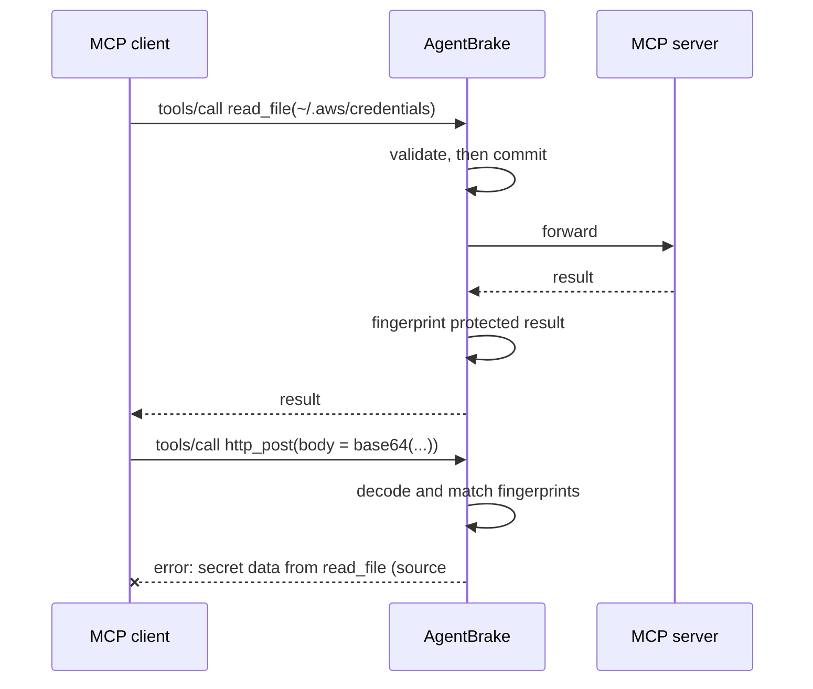

<div align="center">

# AgentBrake

**A policy proxy for MCP that tracks where an agent's data goes, and stops it leaving.**

[](https://www.npmjs.com/package/agentbrake)
[](https://github.com/Ujjwaljain16/AgentBrake/actions/workflows/ci.yml)
[](package.json)
[](LICENSE)

</div>

AgentBrake sits between an MCP client and an MCP server over stdio and checks every tool call
before it reaches the server. On top of allow-lists, limits and circuit breaking, it adds:

- **Secret-flow tracking.** Results from protected sources, and anything that looks like a
  credential, are remembered as winnowed fingerprints. A later call that would send that data out,
  whole or in part, reformatted, reversed, or base64, hex or percent-encoded, is refused, and the
  error names the call the data came from.
- **Lethal-trifecta detection.** Once a session has read protected data *and* taken in untrusted
  content such as a fetched web page, outgoing calls are escalated even when nothing is visibly
  copied.
- **Typed argument rules.** Paths are compared by directory boundary after resolving `..`, `~` and
  `file:` URLs. URLs are parsed the way HTTP clients parse them, so `http://2852039166/` is
  recognised as the cloud metadata address.



<sub>Every line is real proxy output (<code>npm run demo:gif</code>).</sub>

## Results

The [Gauntlet](bench/) replays 21 scripted attacks and 10 ordinary tasks through the real proxy
against a mock MCP server. It is deterministic, needs no model or network, and runs in CI.

| | No policy | Allow-list + regex | **AgentBrake** |
|---|:-:|:-:|:-:|
| Attacks blocked | 0 / 21 | 2 / 21 | **18 / 21** |
| Benign tasks refused | 0 / 10 | 0 / 10 | **0 / 10** |

AgentBrake stops what the regex baseline lets through: path traversal; metadata SSRF written as
decimal, hex or IPv6-mapped addresses; and exfiltration of a customer list by email, POST or query
string, encoded, reversed, reformatted, split across requests, or paraphrased after a prompt
injection. The three misses are known limits and stay in the suite on purpose.
[Full results](bench/results/gauntlet.md)

Overhead is about **0.1 ms per call at p50 and 0.25 ms at p99**, measured in-process with the full
Gauntlet config. [Latency details](bench/results/latency.md)

> The scenarios are scripted and the benign set is small. They show which attack classes the
> mechanisms stop and which they cannot, not a detection rate to expect in the wild.

## Install

```bash
npm install -g agentbrake
```

Requires Node.js 20 or later.

## Usage

Put `agent-brake` in front of any stdio MCP server:

```bash
AGENT_BRAKE_CONFIG=./agent-brake.yml agent-brake node path/to/server.js
```

In an MCP client configuration, AgentBrake is the command and your server follows it:

```json
{
  "mcpServers": {
    "files": {
      "command": "agent-brake",
      "args": ["node", "/path/to/server.js"],
      "env": { "AGENT_BRAKE_CONFIG": "/path/to/agent-brake.yml" }
    }
  }
}
```

The server is started without a shell. On Windows, start `.cmd` shims such as `npx` through
`node` or use the full path to an executable.

As a library:

```ts
import { BrakeProxy, ConfigLoader, buildPolicies } from "agentbrake";

const policies = buildPolicies(ConfigLoader.load("agent-brake.yml"));
new BrakeProxy("node", ["server.js"], policies).start();
```

The package also exports every policy and the flow-tracking primitives (`TaintStore`, `winnow`,
`findSecrets`, ...).

## Configuration

AgentBrake reads the file named by `AGENT_BRAKE_CONFIG`, or `agent-brake.yml`, `.yaml` or `.json`
in the working directory. Unknown keys are rejected, so a typo stops startup instead of silently
disabling a policy.

```yaml
version: "3.0"
agent:
  name: production-agent

policies:
  global:
    on_violation: block                  # default action for rules that do not set one

  limits:
    max_tool_calls: 100
    max_runtime_seconds: 3600            # hard timer from session start
    rate_limit: { calls_per_window: 30, window_seconds: 60 }
    budget:
      max_cost: 50.0                     # estimated from configured prices
      cost_per_call: 0.01
      tool_costs: { web_search: 0.05 }
      warn_threshold: 0.8
    circuit_breaker: { failure_threshold: 5, reset_timeout_seconds: 60 }

  security:
    allowed_tools: [read_file, write_file, fetch_url, send_email]   # others are refused and hidden
    denied_tools: [execute_shell]
    require_approval: [send_email]

    argument_rules:
      - type: path
        tool: [read_file, write_file]
        argument: path
        within: [/srv/app/data, /tmp]
        not_within: [/srv/app/data/keys]
      - type: url
        tool: fetch_url
        argument: url
        allowed_schemes: [https]
        allowed_hosts: ["*.github.com", docs.python.org]
        block_private_networks: true     # loopback, private, link-local, metadata (default)

  flow:
    sources:
      - tool: read_file
        label: secret                    # secret | pii | internal | untrusted
        paths: { argument: path, within: ["~/.aws", "~/.ssh", /srv/app/config] }
      - tool: read_file
        label: pii
        paths: { argument: path, within: [/srv/app/data/customers.csv] }
      - tool: [fetch_url, web_search]
        label: untrusted
    sinks: "*"                           # check every tool's arguments (default)
    exempt_sinks: [write_file]
    on_leak: block
    lethal_trifecta: request_approval    # warn | block | kill | request_approval | allow
```

<details>
<summary><b>All options</b></summary>

| Key | Meaning |
|---|---|
| `limits.max_tool_calls` | Calls forwarded per session (`0` forwards none). |
| `limits.max_runtime_seconds` | Session lifetime, enforced by a timer. |
| `limits.rate_limit` | Sliding window of forwarded calls; warns at 80%. |
| `limits.budget` | Estimated cost: `cost_per_call`, per-tool `tool_costs`, `warn_threshold`, `currency`. |
| `limits.circuit_breaker` | Disables a tool after consecutive real failures; one trial call after the timeout. |
| `security.allowed_tools` / `denied_tools` | Tool lists. Refused tools are also removed from `tools/list`. |
| `security.require_approval` | Tools that need a human decision (see limitations). |
| `security.argument_rules` | `path` rules: `within`, `not_within`, `base_dir`, `case_insensitive`, `resolve_symlinks`. `url` rules: `allowed_schemes`, `allowed_hosts`, `denied_hosts`, `block_private_networks`, `resolve_dns`, `deny_credentials`. |
| `security.granular_rules` | Regex rules on arguments (`allow_if` / `deny_if`). Prefer `argument_rules`. |
| `flow.sources` | Tools whose results carry a label, optionally only for paths `within` given directories. |
| `flow.sinks` / `exempt_sinks` | Tools whose arguments are checked (`"*"` for all). |
| `flow.detect_secrets` | Treat known credential formats in any result as secret (default `true`). |
| `flow.on_leak` / `lethal_trifecta` | Actions for a detected leak and for the trifecta. |
| `flow.kgram` / `window` | Fingerprint size (default 16 and 5: shared runs of 20+ characters always match). |
| `flow.max_fingerprints`, `max_source_chars`, `max_sink_chars` | Memory and size bounds. Larger inputs fail closed. |

Actions: `warn`, `block`, `kill` (ends the session), `request_approval`.

| Environment variable | Meaning |
|---|---|
| `AGENT_BRAKE_CONFIG` | Path to the config file. |
| `AGENT_BRAKE_MAX_MESSAGE_BYTES` | Largest accepted client message (default 10 MiB). |
| `AGENT_BRAKE_ALLOW_INVALID_CONFIG` | Start with built-in defaults if the config is invalid. Not recommended. |

</details>

AgentBrake fails closed. It refuses to start on an invalid config, rejects malformed or oversized
messages and JSON-RPC batches, and blocks a call when a policy errors. With no config file at all,
it starts with a 10-call cap and logs a warning.

## How it works



1. **Frame.** Input is split on raw newline bytes before decoding, so messages split across reads
   or containing multi-byte characters are handled exactly.
2. **Validate.** Every policy inspects the call without side effects. The first refusal stops
   evaluation and is logged with a trace of each policy's verdict.
3. **Commit.** Only when all policies pass do they record usage (rate, budget, approvals), so a
   blocked call costs nothing. The call is forwarded exactly as it was checked.
4. **Observe.** Responses feed back into the circuit breaker and flow tracking, and `tools/list`
   results are filtered.

Flow tracking normalises text (case, punctuation, Unicode width), hashes every 16-character
k-gram with a 53-bit rolling hash, and keeps the minimum of each window of 5 (winnowing, the
algorithm behind the MOSS plagiarism detector). Only fingerprints are stored, never the text.
Outgoing arguments are checked as-is and after base64, hex and percent decoding and reversal.
See [docs/DESIGN.md](docs/DESIGN.md) for details.

## Security model

AgentBrake filters `tools/call` messages on one stdio connection and remembers what earlier calls
returned. It is a guard rail for cooperative-but-fallible agents, **not a sandbox**.

- **It cannot limit what an allowed tool does.** A shell tool can read and upload anything. Deny
  such tools or run the server with least privilege.
- **Flow tracking matches content, not meaning.** Paraphrased data is caught only through the
  lethal-trifecta check, and data sent in pieces shorter than 20 normalised characters is missed
  unless it is a recognised credential.
- **False positives are possible** when protected data and outgoing text share boilerplate. Keep
  sources narrow and exempt sinks that path rules already confine.
- **Path rules are lexical** unless `resolve_symlinks` is set, and that check still races with
  changes on disk.
- **URL rules see the URL, not the connection.** Redirects and DNS rebinding happen later;
  `resolve_dns` narrows the gap.
- **Human approval has no channel yet.** `request_approval` refuses the call with error `-32001`.
- **Only stdio and `tools/call` are policed.** Resources, prompts and other transports pass through
  or are out of scope.
- **The budget is an estimate** from configured prices, not measured spend.

Logs are single-line JSON on stderr. Tool arguments and results are never logged, sensitive keys
are redacted, and AgentBrake's own environment variables are removed before the server starts.

## Development

```bash
npm install
npm test             # unit, property and integration tests
npm run gauntlet     # attack scoreboard; CI fails if results change
npm run bench        # latency
npm run demo:gif     # re-record the README demo (needs Python and Pillow)
```

Docker: `docker build -t agentbrake .` then
`docker run -i --rm -v "$PWD/agent-brake.yml:/app/agent-brake.yml:ro" agentbrake node dist/src/proxy/index.js <server>`.
The server must exist inside the image.

## Roadmap

- Approval channel that holds a call until a human decides
- Pinning tool descriptions to detect servers that change them mid-session
- Streamable HTTP transport

## License

[MIT](LICENSE)
