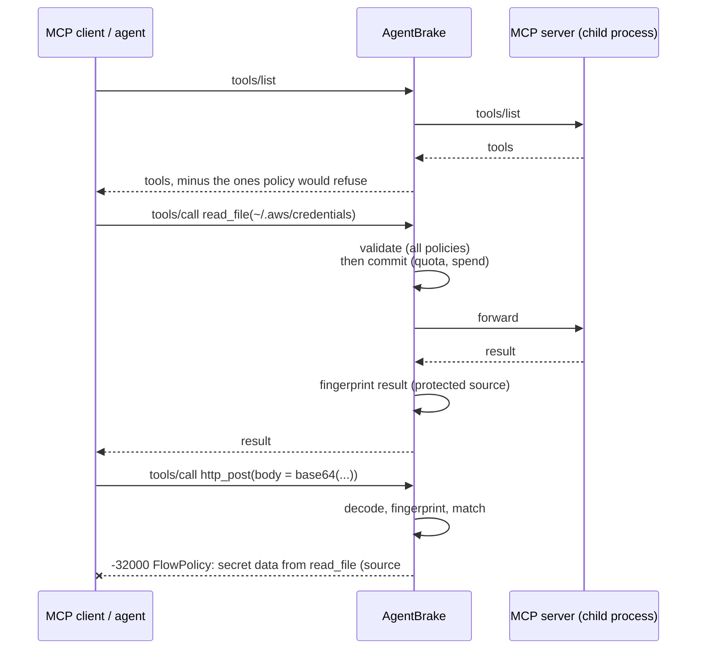

# AgentBrake

**A policy-enforcing MCP proxy that tracks where an agent's data came from, and stops it leaving.**

[](https://github.com/Ujjwaljain16/AgentBrake/actions/workflows/ci.yml)
[](https://opensource.org/licenses/MIT)

AgentBrake wraps an MCP server (stdio), sits between the agent host and that server, and checks every
`tools/call` before forwarding it. Beyond allow-lists, it does three things most tool gateways do not:

- **Secret-flow tracking.** Results from protected sources (and anything that looks like a credential)
  are remembered as *winnowed fingerprints*, the algorithm behind the MOSS plagiarism detector. A
  later call that would carry that data out, even partially, re-formatted, reversed, or base64 / hex /
  percent-encoded, is refused, and the error names the call the data came from.
- **Lethal-trifecta detection.** Once a session has read protected data *and* taken in untrusted
  content (a fetched web page, a search result), outgoing calls are escalated even when no data is
  visibly copied, because the untrusted content may be steering the agent.
- **Typed argument rules.** Paths are compared by directory boundary after resolving `..`, `~` and
  `file:` URLs; URLs after WHATWG parsing, so `http://2852039166/` is recognised as the cloud
  metadata address. No regexes to get wrong.

It is a guard rail for cooperative-but-fallible agents, **not a sandbox**. See
[Security model & limitations](#security-model--limitations).


<sub>Every line in the GIF is real proxy output, recorded by `node dist/bench/demo/capture.js` and drawn by `python bench/demo/render_gif.py`.</sub>

---

## Results

**The Gauntlet** ([bench/](bench/), `npm run gauntlet`) runs 21 scripted attacks and 10 ordinary
tasks through the real proxy against a mock MCP server, three ways. It is deterministic (no model,
no network), and CI fails if any result changes.

| | No policy | Allow-list + regex | **AgentBrake v4** |
|---|---|---|---|
| Attacks blocked | 0 / 21 | 2 / 21 | **18 / 21** |
| Benign tasks wrongly refused | 0 / 10 | 0 / 10 | **0 / 10** |

What the baseline (a tool allow-list plus the regex rules from this project's own v3 example
config) lets through and AgentBrake stops: path traversal, SSRF to the metadata service in decimal,
hex and IPv6-mapped forms, and exfiltration of a customer list by email, POST, query string,
base64, hex, reversal, re-formatting, splitting across requests, and a prompt-injected paraphrase.

The 3 misses are documented limitations, kept in the suite on purpose: a shell command that
uploads a file the proxy never sees, a paraphrased leak with no untrusted content in the session,
and data drip-fed 8 characters per request (shorter than a fingerprint).
[Full table, with the policy that stopped each attack.](bench/results/gauntlet.md)

**Overhead** (`npm run bench`, in-process, 1 KiB argument, full Gauntlet config): about **0.1 ms per
call at p50, 0.3 ms at p99**. The flow check is linear in the outgoing payload, about 150 ms for
1 MiB, and payloads above a configurable cap are refused. [Details.](bench/results/latency.md)

**Read these numbers with care.** The attacks and the defence were written by the same author, the
benign set is small, and the mock server is cooperative. The suite shows which attack *classes* the
mechanisms stop and which they cannot, not a detection rate you should expect in the wild.

---

## Install

```bash
npm install -g agentbrake        # provides the agent-brake command (Node 20+)
agent-brake node path/to/your/server.js
```

As a library, `require("agentbrake")` exports the proxy, every policy, `buildPolicies`, the config
loader and the flow-tracking primitives (`TaintStore`, `winnow`, `findSecrets`, ...).

> npm currently has **1.0.0**, built from a February 2026 commit that predates the fail-closed fixes
> and everything described here. **2.0.0** (see [CHANGELOG](CHANGELOG.md)) is published from CI
> once this version is pushed to `main`.

## Quick start (from source)

```bash
npm install
npm run build
npm test            # 200+ tests
npm run gauntlet    # the attack scoreboard
npm run bench       # latency
```

Wrap any stdio MCP server:

```bash
AGENT_BRAKE_CONFIG=./my-config.yml node dist/src/proxy/index.js node path/to/your/server.js
```

In an MCP client config, AgentBrake is the `command` and your real server follows it:

```json
{
  "mcpServers": {
    "files": {
      "command": "node",
      "args": ["/path/to/AgentBrake/dist/src/proxy/index.js", "node", "/path/to/server.js"],
      "env": { "AGENT_BRAKE_CONFIG": "/path/to/my-config.yml" }
    }
  }
}
```

The server command is started **without a shell**. On Windows, shims such as `npx` (a `.cmd` file)
will not start; use `node script.js` or the full path to an `.exe`.

---

## How it works



1. **Frame.** Client input is split on raw newline bytes before UTF-8 decoding, so messages split
   across reads, or containing multi-byte characters, are handled. Oversized lines are rejected.
2. **Validate.** Each `tools/call` runs through every policy, in order, with no side effects. The
   first policy that blocks stops evaluation; each refusal is logged with a *decision trace* (what
   every policy said).
3. **Commit.** Only if every policy passed do they record usage (rate-limit slot, budget, approval
   token), so a blocked call costs nothing. Then the call is forwarded, re-serialised from the parsed
   value so the server sees exactly what was checked.
4. **Observe.** The server's answer is fed back: the circuit breaker counts failures, flow tracking
   fingerprints protected results, and `tools/list` answers are filtered to hide refused tools.

Policy order: max tool calls, max runtime, rate limit, denied tools, allowed tools, regex rules,
typed argument rules, flow tracking, approval, circuit breaker, budget.

### Flow tracking in detail

| Step | What happens |
|---|---|
| Normalise | NFKC, lower case, keep only `[a-z0-9]`, so spacing, punctuation, case and full-width characters do not matter. |
| Fingerprint | 53-bit rolling hash (two 32-bit polynomial hashes) of every 16-character k-gram; winnowing keeps the minimum of each window of 5. Any shared run of 20 normalised characters is guaranteed to share a fingerprint (property-tested). |
| Remember | Only fingerprints are stored, never the text. Capped (500k by default), oldest sources evicted first. |
| Detect credentials | AWS keys, private-key blocks, GitHub / Slack / Stripe / `sk-` tokens, Google API keys, JWTs and `*_SECRET=` / `*_PASSWORD=` assignments in **any** result become protected, even from tools nobody configured. Short ones are matched exactly. |
| Check sinks | Outgoing arguments are checked as-is and after base64 / base64url / hex / percent decoding (nested two deep, with an output budget) and reversal. |
| Escalate | Protected data + untrusted content in one session: sink calls get the `lethal_trifecta` action. |
| Fail closed | A protected result too large to fingerprint completely, or an outgoing argument above `max_sink_chars`, refuses the sink call. |

---

## Configuration

AgentBrake reads `AGENT_BRAKE_CONFIG`, else `./agent-brake.yml`, `.yaml` or `.json`. Unknown keys
are rejected, so a typo such as `allowed_tool` stops startup instead of silently disabling a policy.
[`examples/enterprise-config.yml`](examples/enterprise-config.yml) and
[`bench/configs/agentbrake.yml`](bench/configs/agentbrake.yml) are complete examples.

```yaml
version: "3.0"
agent:
  name: "production-agent"

policies:
  global:
    on_violation: block          # default action for rules that do not set one

  limits:
    max_tool_calls: 100          # forwarded calls (0 = none)
    max_runtime_seconds: 3600    # hard timer from session start
    rate_limit: { calls_per_window: 30, window_seconds: 60 }
    budget:
      max_cost: 50.0
      cost_per_call: 0.01        # estimate per forwarded call...
      tool_costs: { web_search: 0.05 }   # ...unless the tool is priced here
      warn_threshold: 0.8
      currency: USD
    circuit_breaker: { failure_threshold: 5, reset_timeout_seconds: 60 }

  security:
    denied_tools: [execute_shell]
    allowed_tools: [read_file, write_file, fetch_url, send_email]   # everything else is refused and hidden
    require_approval: [send_email]          # see "Human approval" below

    argument_rules:
      - type: path
        tool: [read_file, write_file]
        argument: path
        within: [/srv/app/data, /tmp]       # directory boundaries, not string prefixes
        not_within: [/srv/app/data/keys]
        resolve_symlinks: false             # true: realpath before comparing
      - type: url
        tool: fetch_url
        argument: url
        allowed_schemes: [https]
        allowed_hosts: ["*.github.com", docs.python.org]   # "*.x" = subdomains only
        denied_hosts: [gist.github.com]
        block_private_networks: true        # loopback, RFC 1918, link-local, metadata, ULA ... (default)
        resolve_dns: false                  # true: also refuse names that resolve to private addresses
        deny_credentials: true              # refuse user:pass@host (default)

    granular_rules:                         # regex rules (v3); prefer argument_rules
      - tool: query_database
        deny_if: { arguments: { query: "\\b(DROP|TRUNCATE|ALTER|drop|truncate|alter)\\b" } }

  flow:
    sources:
      - tool: read_file
        label: secret                       # secret | pii | internal | untrusted
        paths: { argument: path, within: ["~/.aws", "~/.ssh", /srv/app/config] }
      - tool: read_file
        label: pii
        paths: { argument: path, within: [/srv/app/data/customers.csv] }
      - tool: [fetch_url, web_search]
        label: untrusted
    sinks: "*"                              # default: every tool's arguments are checked
    exempt_sinks: [write_file]              # e.g. already confined by a path rule
    detect_secrets: true
    on_leak: block
    lethal_trifecta: request_approval       # warn (default) | block | kill | request_approval | allow
    max_sink_chars: 1048576
```

Settings that are accepted but not enforced (`agent.trust_level`, `policies.global.max_retries`)
log a warning at startup.

### Fail-closed configuration

| Situation | Behaviour |
|---|---|
| Config file malformed, fails validation, or has an invalid/dangerous regex or path | **Refuses to start** (exit 2) |
| `AGENT_BRAKE_CONFIG` points at a missing file | **Refuses to start** |
| A discovered `agent-brake.*` file is broken | **Refuses to start** (never skipped) |
| No config file anywhere | Starts with built-in defaults: only a **10-call cap** (a warning is logged) |
| `AGENT_BRAKE_ALLOW_INVALID_CONFIG=1` and the config is invalid | Starts with the defaults **instead of your policies**, with a loud warning |

### Environment variables

| Variable | Meaning |
|---|---|
| `AGENT_BRAKE_CONFIG` | Path to the config file |
| `AGENT_BRAKE_ALLOW_INVALID_CONFIG` | `1`/`true`: fall back to defaults if the config is invalid (not recommended) |
| `AGENT_BRAKE_MAX_MESSAGE_BYTES` | Max size of one client message line (default 10 MiB) |

---

## Docker

The image runs as a non-root user and listens on no port: the proxy speaks MCP over stdin/stdout,
so run it with `-i`. It can only wrap a server that exists inside the image.

```bash
docker build -t agentbrake .
docker run -i --rm \
  -v "$PWD/my-config.yml:/app/agent-brake.yml:ro" \
  agentbrake node dist/src/proxy/index.js node dist/examples/enterprise-tools.js
```

## Logging and secrets

- Logs are single-line JSON on **stderr**: violations with decision traces, warnings, `FLOW_SOURCE`
  and `FLOW_LEAK` events, `TOOLS_HIDDEN`, lifecycle. Log lines stay the same size however long a
  session runs.
- Tool arguments and results are never logged. Values under sensitive-looking keys are redacted and
  long strings truncated in any logged context. Flow tracking stores fingerprints, not text.
- Only the executable name and argument count of the wrapped command are logged.
- `AGENT_BRAKE_*`, `WEBHOOK_URL` and `SLACK_WEBHOOK_URL` are removed from the wrapped server's
  environment.

## Human approval (not implemented)

`require_approval` (and the `request_approval` action) mark calls that should need a human decision.
There is no approval channel yet, so these calls are **always refused** (error `-32001`, status
`pending`). Treat them as a stricter deny for now.

---

## Security model & limitations

**What AgentBrake is:** an application-level filter for `tools/call` messages on one MCP stdio
connection, with memory of what earlier calls returned.

**What it is not:**
- **Not a sandbox.** It cannot restrict what an allowed tool does once a call is forwarded. A shell
  tool can read and upload anything (Gauntlet M01). Deny such tools, or run the server in a
  container or VM with least privilege.
- **Not a semantic leak detector.** Flow tracking matches content, not meaning. A paraphrase (M02)
  or data sent in pieces shorter than 20 normalised characters (M03) is not detected; the
  lethal-trifecta check covers paraphrase only when untrusted content entered the session. Text
  shorter than a fingerprint is only caught for detected credential formats.
- **False positives are possible.** Any 16+ character run shared between protected data and an
  outgoing call matches, including boilerplate. Keep `sources` narrow (specific directories, not
  whole repositories) and use `exempt_sinks` for tools already confined by path rules.
- **Path rules are lexical by default.** Symlinks and hard links can point out of an allowed
  directory unless `resolve_symlinks: true` (which still races with changes on disk). Windows 8.3
  short names are not expanded.
- **URL rules see the URL, not the connection.** Redirects and DNS rebinding happen after the
  check; `resolve_dns: true` narrows but does not close that gap.
- **Stdio only.** HTTP/SSE transports are not proxied; anything that can reach the server another way
  bypasses AgentBrake. Only `tools/call` is policed (plus `tools/list` filtering); resources,
  prompts and server-to-client requests pass through.
- **Regex rules are heuristics.** Patterns are length-limited and nested quantifiers rejected, but
  string patterns remain bypassable; prefer `argument_rules`.
- **The budget is an estimate** from configured prices, not measured spend.

**Fail-closed behaviour on the enforcement path:** invalid UTF-8, invalid JSON, non-objects,
oversized lines and JSON-RPC batches are rejected; malformed `tools/call` params are rejected; a
policy that throws (while validating or committing) blocks the call; unknown actions and `sandbox`
are enforced as blocks; a tool-visibility check that throws hides the tool; non-JSON server output
is dropped.

---

## Development

```bash
npm test             # unit, property and proxy tests
npm run lint         # tsc --noEmit
npm run gauntlet     # writes bench/results/gauntlet.{md,json}; CI checks they are unchanged
npm run bench        # writes bench/results/latency.{md,json}
npm run demo:gif     # re-records docs/media/demo-transcript.json and redraws demo.gif (needs Python + Pillow)
```

Plan and scope: [docs/PLAN-v4.md](docs/PLAN-v4.md).

## Roadmap

- [x] V1-V3: allow/deny lists, regex rules, limits, circuit breaker, fail-closed handling, Docker
- [x] V4: two-phase policy engine with decision traces, `tools/list` filtering, typed path/URL rules,
      secret-flow tracking with winnowing, lethal-trifecta detection, the Gauntlet, latency benchmark
- [ ] Human approval channel (hold the call, approve or deny)
- [ ] Tool-description pinning (detect a server changing its tools mid-session)
- [ ] Streamable HTTP transport

## License

MIT © Ujjwal Jain
